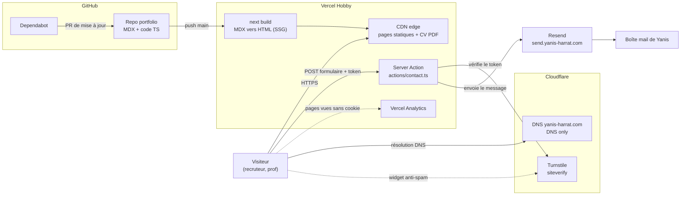

# INSTALL.md - Portfolio Yanis Harrat

Vision technique et guide d'installation du portfolio publié sur [yanis-harrat.com](https://yanis-harrat.com).

## Vision

Présenter mon parcours BTS SIO SISR, mes projets d'infra/réseau et mes compétences pour décrocher un stage ou une alternance.

Le site s'adresse aux recruteurs, aux entreprises qui cherchent un alternant et aux professeurs, soit environ 50 à 200 visiteurs uniques par mois. Il se démarque par un accueil animé soigné et une page dédiée à chaque projet et réalisation professionnelle, sans sacrifier le SEO ni le score Lighthouse. Il comprend aussi une section de veille technologique, un CV téléchargeable et un formulaire de contact protégé contre le spam. Le tout fonctionne à 0 €/mois, uniquement sur des offres gratuites, et respecte le RGPD.

## Decisions

| Décision     | Choix | Pourquoi |
| ------------ | ----- | -------- |
| Architecture | Monolithe Next.js : pages SSG + une fonction serverless (contact) | Un seul développeur, un trafic très faible, pas de temps réel : un seul repo et un seul déploiement suffisent. |
| Front-end    | Next.js 16 (App Router, SSG, TypeScript), `@next/mdx`, shadcn/ui + Tailwind v4, GSAP + Motion | SEO important, donc HTML pré-rendu. Next.js et TypeScript sont déjà maîtrisés. Le contenu est en MDX dans le repo, demandé explicitement. |
| Back-end     | Server Action Next.js (TypeScript) sur Vercel Functions | Le formulaire de contact est le seul besoin serveur. Pas de backend séparé, pas de CORS. |
| Database     | Aucune | Le contenu est en MDX versionné. Les messages de contact sont envoyés par mail et ne sont pas stockés (minimisation RGPD). |
| Auth         | Aucune | Site public, pas d'espace admin : le contenu se publie par commit. |
| Hosting      | Vercel Hobby, DNS chez Cloudflare (DNS only), Resend Free, Cloudflare Turnstile, Vercel Analytics | Budget de 0 €/mois, préférence pour Vercel, domaine déjà géré chez Cloudflare. |

### Garde-fous issus de l'audit

- **DNS :** tous les enregistrements qui pointent vers Vercel ou Resend sont en **DNS only** (nuage gris). Le proxy Cloudflare provoque une boucle SSL, un cache en double et casse le Bot Protection de Vercel.
- **Vercel Hobby (non commercial) :** aucune offre de prestation, de pub ni de paiement sur le site. Si une activité freelance démarre, il faudra passer en Pro ou migrer.
- **Animations :**
  - GSAP (`useGSAP` + ScrollTrigger) sert à l'accueil et aux animations liées au scroll.
  - Motion (via `LazyMotion`/`m`) sert aux micro-interactions.
  - Un élément n'est jamais animé par les deux librairies.
  - Le H1 de l'accueil (élément LCP) n'est jamais à `opacity: 0` au rendu SSR.
  - `prefers-reduced-motion` est respecté.
  - Tous les composants animés sont en `"use client"`.
- **MDX :** les plugins remark/rehype sont déclarés sous forme de *strings* dans `next.config.ts`, ce qu'exige Turbopack. `next-mdx-remote` est exclu (archivé en avril 2026).
- **Turnstile :** le token est vérifié côté serveur via `siteverify` dans la Server Action. Il est à usage unique et expire après 300 s, donc le widget est réinitialisé après chaque envoi.
- **Resend :** utiliser le package unifié `react-email` si besoin. `@react-email/components` est déprécié. Un mail texte/HTML simple suffit.
- **RGPD :** la page `mentions-legales` déclare les trois sous-traitants :
  - Resend : stockage aux États-Unis, rétention de 30 jours ;
  - Cloudflare Turnstile : base légale de l'intérêt légitime ;
  - Vercel Analytics : sans cookie, hash effacé au bout de 24 h.

  Aucune bannière cookies n'est nécessaire.
- **Sécurité :** Dependabot est activé dès le premier commit, car Next.js publie des security releases mensuelles.

## Stack summary

- **Front-end :**
  - `next` 16.4.x (Turbopack), `react` / `react-dom` 19.3.x, TypeScript
  - `tailwindcss` 4.x, shadcn CLI 4.x (base Radix, preset `nova` : style `radix-nova`, `tw-animate-css`, `sonner` pour les toasts)
  - `gsap` 3.15.x + `@gsap/react` 2.x (licence gratuite, y compris les plugins), `motion` 14.x
  - `@next/mdx` 16.4.x
- **Back-end :** Server Actions Next.js (`"use server"`), validation du formulaire, client `resend` 6.x
- **Database :** aucune
- **Auth :** aucune
- **Hosting :** Vercel Hobby (1 M d'invocations, 100 GB de transfert et 4 h d'Active CPU par mois), Cloudflare DNS (offre Free)
- **Key integrations :**
  - Resend Free (3 000 mails/mois, 100/jour) sur le sous-domaine `send.yanis-harrat.com`
  - Cloudflare Turnstile, avec `@marsidev/react-turnstile` (lib communautaire, Cloudflare ne fournit pas de lib React officielle)
  - `@vercel/analytics` 2.x (Hobby : 50 000 événements/mois, 1 mois d'historique, pas d'événements custom)
- **Outillage :** PNPM, GitHub, Dependabot

Les versions ont été vérifiées sur npm le 10/11/2026. Épingler les versions exactes à l'installation.

## Architecture



Tout le contenu (accueil, projets, veille, mentions légales) est pré-rendu en HTML au build à partir des fichiers MDX, puis servi par le CDN de Vercel. Le seul code exécuté côté serveur est la Server Action `actions/contact.ts`. Elle valide le formulaire, vérifie le token Turnstile auprès de Cloudflare, puis transmet le message via Resend, sans rien persister. Cloudflare ne joue que deux rôles : résoudre le DNS (sans proxy) et fournir Turnstile. Vercel gère le SSL, le CDN et l'analytics.

## Folder structure

```
portfolio/
├── .github/
│   └── dependabot.yml            # mises à jour de sécurité Next.js
├── aidd_docs/
│   ├── INSTALL.md                # ce document
│   └── memory/                   # mémoire projet
├── public/
│   ├── cv/yanis-harrat-cv.pdf    # CV téléchargeable
│   ├── images/projets/
│   └── favicon.ico
├── src/
│   ├── app/
│   │   ├── layout.tsx            # fonts, metadata globale, <Analytics />
│   │   ├── globals.css           # Tailwind v4 (@theme) + tokens shadcn
│   │   ├── page.tsx              # accueil animé (GSAP)
│   │   ├── projets/
│   │   │   ├── page.tsx          # liste des projets et réalisations
│   │   │   └── [slug]/page.tsx   # une page par projet (generateStaticParams)
│   │   ├── veille/
│   │   │   ├── page.tsx          # liste des articles de veille
│   │   │   └── [slug]/page.tsx
│   │   ├── contact/page.tsx      # formulaire + widget Turnstile
│   │   ├── mentions-legales/page.tsx  # RGPD : Resend, Turnstile, Analytics
│   │   ├── sitemap.ts
│   │   ├── robots.ts
│   │   ├── opengraph-image.tsx
│   │   └── not-found.tsx
│   ├── actions/
│   │   └── contact.ts            # "use server" : validation, Turnstile, Resend
│   ├── components/
│   │   ├── ui/                   # composants shadcn/ui
│   │   ├── layout/               # header, footer, nav
│   │   ├── animations/           # GSAP (hero, scroll) · Motion (micro-interactions)
│   │   ├── mdx/                  # composants utilisables dans le MDX
│   │   └── contact-form.tsx
│   ├── content/
│   │   ├── projets/*.mdx         # 1 fichier = 1 projet
│   │   └── veille/*.mdx
│   ├── lib/
│   │   ├── content.ts            # listing MDX + métadonnées
│   │   ├── turnstile.ts          # appel siteverify
│   │   ├── resend.ts             # client Resend
│   │   └── utils.ts              # cn()
│   └── mdx-components.tsx        # requis par @next/mdx
├── .env.example                  # RESEND_API_KEY, TURNSTILE_SECRET_KEY, NEXT_PUBLIC_TURNSTILE_SITE_KEY
├── components.json               # config shadcn
├── next.config.ts                # @next/mdx (plugins déclarés en strings)
├── tsconfig.json
├── package.json + pnpm-lock.yaml
└── README.md
```

## Install steps

Installation manuelle : le framework ne génère pas encore ces éléments automatiquement.

1. **Initialiser le repo :**
   - `git init` dans `~/Developer/Portfolio` ;
   - créer le repo GitHub ;
   - activer Dependabot (security updates + `dependabot.yml`) ;
   - protéger la branche `main`.
2. **Vérifier les runtimes :** Node.js LTS et PNPM sont installés. Initialiser Next.js 16 (App Router, TypeScript, Tailwind v4, `src/`) avec PNPM, puis `shadcn init`.
3. **Créer les comptes gratuits :**
   - Vercel Hobby, relié au repo GitHub ;
   - Resend Free ;
   - Cloudflare Turnstile : créer un widget pour `yanis-harrat.com` et `localhost`.
4. **Configurer le DNS chez Cloudflare :**
   - ajouter le domaine dans Vercel, puis créer les enregistrements demandés en **DNS only** ;
   - vérifier `send.yanis-harrat.com` dans Resend (Domain Connect, ou MX `send` + TXT `resend._domainkey` en DNS only) ;
   - ajouter un DMARC `p=none`.
5. **Renseigner les variables d'environnement :**
   - variables : `RESEND_API_KEY`, `TURNSTILE_SECRET_KEY`, `NEXT_PUBLIC_TURNSTILE_SITE_KEY`, `CONTACT_TO_EMAIL` ;
   - en local, les mettre dans `.env.local` (non commité) et documenter les clés dans `.env.example` ;
   - en Preview et en Production, les déclarer dans Vercel.
6. **Activer Vercel Analytics** dans le dashboard du projet, puis rédiger la page `mentions-legales` qui déclare Resend, Turnstile et Vercel Analytics.

## Audit summary

Résultats de l'audit multi-agents de l'action 03 :

| Candidate | Verdict | Notes |
| --------- | ------- | ----- |
| **A : Next.js full-stack sur Vercel** ✅ retenue | ⚠️ | Stack viable et cohérente, 0 € réaliste. Les réserves sont de la configuration : DNS only, zone grise des CGU Hobby, pas d'événements custom en Analytics, déclarations RGPD, doublon Motion + GSAP. |
| **B : Static export + Worker Cloudflare** | ⚠️ | Fonctionne à 0 €, mais impose 2 déploiements et du CORS. Fait perdre les Server Actions, `next/image` optimisé et `redirects` sans gain, puisque Vercel Hobby inclut déjà les fonctions. |
| **C : Tout chez Cloudflare (OpenNext)** | ⚠️ | Cloudflare recommande désormais vinext (bêta) plutôt qu'OpenNext. Limite de 10 ms de CPU par requête en Free (erreur 1102 possible), pas de Vercel Analytics, 2 à 3 jours de mise en place. |
