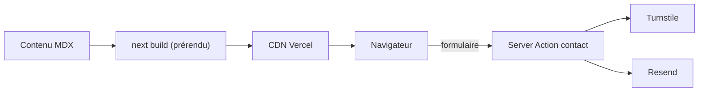

# Architecture

La forme technique d'ensemble : la stack, comment les pièces s'emboîtent et les décisions qui la justifient. Le détail complet et l'audit des alternatives sont dans `aidd_docs/INSTALL.md`.

## Stack

- TypeScript + Next.js (App Router) avec Cache Components (le défaut de Next 16.4) : toutes les pages sont prérendues au build, et le SEO est important. Les helpers de contenu sont en `'use cache'` + `cacheLife('max')`, d'où la revalidation « 30d / 1y » affichée au build. Les `[slug]` ont un shell de repli (◐) pour les slugs inconnus, qui répondent 404 grâce à `ensureStatic = 'navigation'`.
- Contenu en MDX via `@next/mdx`, versionné dans le repo. Il n'y a ni CMS ni base de données.
- UI : shadcn/ui + Tailwind CSS. Animations : GSAP seul (`@gsap/react`, ScrollTrigger).
- Package manager : PNPM.

## How it fits together

## Key decisions

- **Monolithe Next.js, sans backend séparé.** Le seul besoin serveur est le formulaire de contact, traité par une Server Action. Le static export et le Worker Cloudflare ont été écartés : ils imposaient 2 déploiements et du CORS sans aucun gain.
- **Ni base de données ni auth.** Les messages de contact partent par mail sans être stockés (minimisation RGPD). Le contenu se publie par commit.
- **Budget de 0 €/mois.** Uniquement des offres gratuites (Vercel Hobby, Resend Free, Turnstile, Vercel Analytics). Aucune dépendance payante sans décision explicite.
- **Vercel Hobby = usage non commercial.** Pas d'offre de prestation, de pub ni de paiement sur le site. Une activité freelance imposerait de passer en Pro ou de migrer.
- **Une seule librairie d'animation.** GSAP porte toute la mise en scène au défilement. `motion` a été retiré avec l'ancien accueil. Le détail est dans `design.md`.
- **Modèle d'un projet.** Le `metadata` d'une fiche MDX porte, en plus du titre et de la date, `featured` et `rank` (à la une sur l'accueil), `status` (`released`, `in-progress`, `upcoming`), `context` (le cadre : `entreprise`, `formation` ou `personnel`, par défaut `personnel`), `domain` et `poster` (titre court de l'affiche), `cover` (image de l'affiche, chemin dans `public/images/projets/`). Toute fiche (projet ou veille) peut porter `seoTitle` (titre de l'onglet et des résultats, si le titre dépasse 60 caractères avec « · Yanis Harrat ») et `description` (meta description, si le résumé dépasse 160 caractères), sans changer ce qui est affiché. Toute fiche peut aussi lister des `documents` (`{ label, href }`) : un fichier de `public/documents/<slug>/` ou un lien externe. L'accueil montre 3 projets à la une, `/projets` les liste tous.
- **Filtre du catalogue côté client.** Sous Cache Components, la page ne lit pas `searchParams` : les filtres (cadre et domaine, combinables) sont un état React, recopié dans l'adresse (`?cadre=…&domaine=…`) après l'hydratation pour être partagés ; la page reste prérendue. Un groupe de filtres n'apparaît que s'il départage au moins deux valeurs : la page grandit avec les projets sans réglage.

## Gotchas

- Les CSS modules ne sont pas disponibles : la règle Turbopack `*.css` de `next.config.ts` envoie tout au loader Tailwind. Le style passe par des classes Tailwind et les tokens de `globals.css`.
- `cn()` vient du paquet `cn` de shadcn (remplaçant de `clsx` + `tailwind-merge`), configuré dans `src/lib/utils.ts` avec les tailles de texte du thème.
- TypeScript 6 et 7 sont installés côte à côte (montage recommandé par Microsoft) : `@typescript/native` est TypeScript 7 et fournit `tsc` (`pnpm typecheck`) ; `typescript` est un alias de `@typescript/typescript6`, car TypeScript 7 n'a pas d'API JavaScript et `typescript-eslint` en a besoin. `next build` contrôle les types avec ce paquet `typescript`, donc avec TypeScript 6 (`tsc6`). Ne pas remettre `typescript` en version 7 tant que `typescript-eslint` ne la supporte pas (son backend `tsgo` vise TypeScript 7.1).
- ESLint 10 : `eslint-config-next` (16.4 et plus) corrige lui-même `eslint-plugin-react`, `eslint-plugin-import` et son parser Babel. Les avertissements de peer de ces plugins (`eslint` ≤ 9 déclaré) sont attendus.
- `next-mdx-remote` est archivé : ne pas l'utiliser. Sous Turbopack, les plugins remark/rehype se déclarent sous forme de *strings* dans `next.config.ts`.
- Next.js publie des security releases fréquentes : Dependabot doit rester actif, et ses PR doivent être traitées vite.
