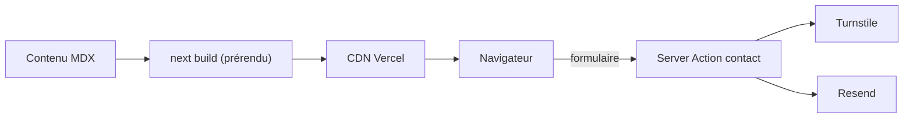

# Architecture

La forme technique d'ensemble : la stack, comment les pièces s'emboîtent et les décisions qui la justifient. Le détail complet et l'audit des alternatives sont dans `aidd_docs/INSTALL.md`.

## Stack

- TypeScript + Next.js (App Router) avec Cache Components (le défaut de Next 16.4) : toutes les pages sont prérendues au build, et le SEO est important. Les helpers de contenu sont en `'use cache'` + `cacheLife('max')`, d'où la revalidation « 30d / 1y » affichée au build. Les `[slug]` ont un shell de repli (◐) pour les slugs inconnus, qui répondent 404 grâce à `ensureStatic = 'navigation'`.
- Contenu en MDX via `@next/mdx`, versionné dans le repo. Il n'y a ni CMS ni base de données.
- UI : shadcn/ui + Tailwind CSS. Animations : GSAP seul (`@gsap/react`, ScrollTrigger).
- Package manager : PNPM.

## How it fits together

## Key decisions

- **Monolithe Next.js, sans backend séparé.** Le seul besoin serveur est le formulaire de contact, traité par une Server Action. Le static export et le Worker Cloudflare ont été écartés : ils imposaient 2 déploiements et du CORS sans aucun gain.
- **Ni base de données ni auth.** Les messages de contact partent par mail sans être stockés (minimisation RGPD). Le contenu se publie par commit.
- **Budget de 0 €/mois.** Uniquement des offres gratuites (Vercel Hobby, Resend Free, Turnstile, Vercel Analytics). Aucune dépendance payante sans décision explicite.
- **Vercel Hobby = usage non commercial.** Pas d'offre de prestation, de pub ni de paiement sur le site. Une activité freelance imposerait de passer en Pro ou de migrer.
- **Une seule librairie d'animation.** GSAP porte toute la mise en scène au défilement. `motion` a été retiré avec l'ancien accueil. Le détail est dans `design.md`.
- **Modèle d'un projet.** Le `metadata` d'une fiche MDX porte, en plus du titre et de la date, `featured` et `rank` (à la une sur l'accueil), `status` (`released`, `in-progress`, `upcoming`), `domain` et `poster` (titre court de l'affiche). L'accueil montre 3 projets à la une, `/projets` les liste tous.
- **Filtre du catalogue côté client.** Sous Cache Components, la page ne lit pas `searchParams` : le filtre par domaine est un état React, la page reste prérendue.

## Gotchas

- Les CSS modules ne sont pas disponibles : la règle Turbopack `*.css` de `next.config.ts` envoie tout au loader Tailwind. Utiliser du CSS global préfixé.
- `next-mdx-remote` est archivé : ne pas l'utiliser. Sous Turbopack, les plugins remark/rehype se déclarent sous forme de *strings* dans `next.config.ts`.
- Next.js publie des security releases fréquentes : Dependabot doit rester actif, et ses PR doivent être traitées vite.
