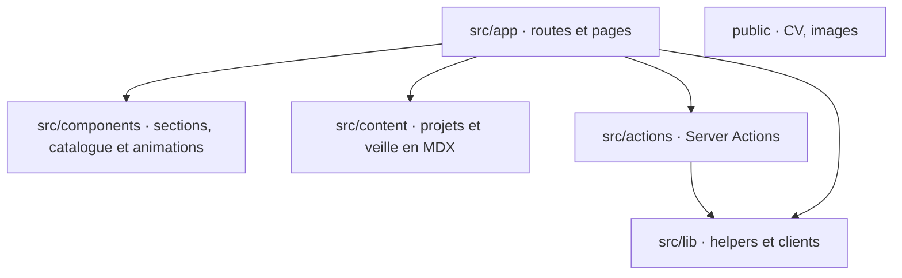

# Codebase Map

Les grandes zones du code et ce que contient chacune. C'est une carte pour s'orienter, pas l'arborescence complète, qui se trouve dans `aidd_docs/INSTALL.md`.

## Areas

- `src/app` : les routes de l'App Router (accueil, projets, veille, contact, mentions légales), `sitemap.ts`, `robots.ts` et `fonts/` (les trois polices locales). L'image OpenGraph est à venir.
- `src/components/home` : les six sections de l'accueil « Générique », en Server Components (`hero`, `acts`, `bill`, `sheet`, `awards`, `finale`), l'affiche de projet (`poster.tsx`, `status-badge.tsx`), la couronne (`laurel.tsx`) et leur CSS (`home.css`, `poster.css`).
- `src/components/projects` : le catalogue filtrable de `/projets` (`catalog.tsx`, composant client).
- `src/components/animations` : la mise en scène GSAP, toujours en `"use client"` (`hero-scroll`, `acts-scroll`, `reveal`, `gsap.ts`).
- `src/components` (autres) : `layout/` (header fixe, footer), `content/` (liste, métadonnées et page de détail, utilisées par la veille et les fiches projet), `mdx/` (rendu `prose`) et `seo/` (JSON-LD de la personne). À venir : `ui/` pour les composants shadcn.
- `src/types` : les déclarations de modules, dont `*.mdx` (qui type `export const metadata`).
- `src/content` : un fichier MDX par projet ou article de veille. On ajoute du contenu ici.
- `src/actions` (à venir) : les Server Actions, à commencer par le formulaire de contact.
- `src/lib` :
  - `content.ts` : listing du contenu MDX, côté serveur (`getProjects`, `getFeaturedProjects`).
  - `projects.ts` : modèle d'un projet, utilisable côté client (statuts, domaines, `pickFeatured`).
  - `profile.ts` : le contenu de l'accueil (`OPENING`, `ACTS`, `SHEET`, `CERTIFICATIONS`). Il n'est pas dans `src/content/`, que Vitest redirige vers les fixtures.
  - `site.ts` : constantes du site (`SITE_URL`, `OWNER`, `CONTACT`, `CV_PATH`, `BASE_OPEN_GRAPH`), et `utils.ts` pour `cn()`.
  - À venir : le client Resend et l'appel Turnstile.
- `public` : le CV en PDF (`cv/`), le portrait et les images des projets. Les badges officiels des certifications iront dans `images/certifs/`.

## Entry points

- `src/app/layout.tsx` : le layout racine (fonts, metadata globale, Vercel Analytics).
- `src/mdx-components.tsx` : obligatoire pour `@next/mdx`.
- `next.config.ts` : la configuration MDX.
