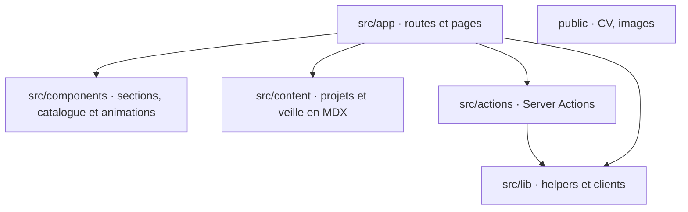

# Codebase Map

Les grandes zones du code et ce que contient chacune. C'est une carte pour s'orienter, pas l'arborescence complète, qui se trouve dans `aidd_docs/INSTALL.md`.

## Areas

- `src/app` : les routes de l'App Router (accueil, projets, veille, contact, mentions légales), `sitemap.ts`, `robots.ts`, `fonts/` (les trois polices locales) et `globals.css` (tous les tokens de design). L'image OpenGraph est à venir.
- `src/actions` : les Server Actions. `contact.ts` reçoit le formulaire de contact.
- `src/app/api/resend-webhook` : la seule route `POST`, le webhook Resend qui alerte des mails du formulaire non remis.
- `src/components/ui` : les primitives shadcn/ui, thémées (bouton, badge, carte, filtres, champs, toasts).
- `src/components/home` : les six sections de l'accueil « Générique », en Server Components (`hero`, `acts`, `bill`, `sheet`, `awards`, `finale`), et la couronne (`laurel.tsx`).
- `src/components/projects` : ce que l'accueil et le catalogue partagent (`poster.tsx`, `status-badge.tsx`) et le catalogue filtrable de `/projets` (`catalog.tsx`, composant client).
- `src/components/contact` : le formulaire de contact (`contact-form.tsx`, composant client, rendu seul) et ses deux hooks : `use-contact-draft.ts` (brouillon de l'onglet, motif) et `use-turnstile-gate.ts` (attente du jeton Turnstile, envoi automatique).
- `src/components/animations` : la mise en scène GSAP, toujours en `"use client"` (`hero-scroll`, `acts-scroll`, `reveal`, `gsap.ts`).
- `src/components` (autres) : `layout/` (header fixe, footer, en-tête des pages intérieures), `content/` (liste de la veille, page de détail des fiches et articles, sommaire `sequence-nav`, appel « → » partagé `action-cue`), `mdx/` (rendu `prose`, aussi utilisé par les mentions légales) et `seo/` (JSON-LD de la personne).
- `src/types` : les déclarations de modules, dont `*.mdx` (qui type `export const metadata`).
- `src/content` : un fichier MDX par projet ou article de veille. On ajoute du contenu ici.
- `src/lib` :
  - `content.ts` : listing du contenu MDX, côté serveur (`getProjects`).
  - `headings.ts` : plan d'une fiche lu dans sa source MDX (intertitres, ancres, temps de lecture), sans dépendance serveur.
  - `typography.ts` (espaces insécables) et `title-fit.ts` (taille d'un titre pour que son mot le plus long tienne).
  - `projects.ts` : modèle d'un projet, utilisable côté client (statuts, domaines, `pickFeatured`).
  - `profile.ts` : le contenu de l'accueil (`OPENING`, `ACTS`, `SHEET`, `CERTIFICATIONS`). Il n'est pas dans `src/content/`, que Vitest redirige vers les fixtures.
  - `contact.ts` : règles et messages du formulaire, sans dépendance serveur ; `contact-emails.ts` : les deux mails (notification, accusé de réception) ; `turnstile.ts` et `resend.ts` : les deux appels externes, côté serveur.
  - `site.ts` : constantes du site (`SITE_URL`, `OWNER`, `CONTACT`, `CV_PATH`, `BASE_OPEN_GRAPH`).
  - `utils.ts` : `cn()`, configuré avec les tailles de texte du thème.
- `tests/visual` : `capture.mjs` et `compare.mjs`, pour comparer le rendu avant et après une réécriture de styles.
- `public` : le CV en PDF (`cv/`) et le portrait. Les badges officiels des certifications iront dans `images/certifs/`.

## Entry points

- `src/app/layout.tsx` : le layout racine (fonts, metadata globale, Vercel Analytics).
- `src/mdx-components.tsx` : obligatoire pour `@next/mdx`.
- `next.config.ts` : la configuration MDX.
- `DESIGN.md` : la référence du design system ; `PRODUCT.md` : la vérité produit.
