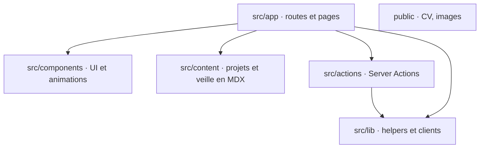

# Codebase Map

Les grandes zones du code et ce que contient chacune. C'est une carte pour s'orienter, pas l'arborescence complète, qui se trouve dans `aidd_docs/INSTALL.md`.

## Areas

- `src/app` : les routes de l'App Router (accueil, projets, veille, contact, mentions légales) ainsi que `sitemap.ts` et `robots.ts`. L'image OpenGraph est à venir.
- `src/components` : `layout/` (header, footer), `content/` (liste de cartes, métadonnées et page de détail partagées par projets et veille) et `mdx/` (rendu `prose`). À venir : `ui/` pour les composants shadcn ajoutés via la CLI, et `animations/` (GSAP et Motion, toujours en `"use client"`).
- `src/types` : les déclarations de modules, dont `*.mdx` (qui type `export const metadata`).
- `src/content` : un fichier MDX par projet ou article de veille. On ajoute du contenu ici.
- `src/actions` (à venir) : les Server Actions, à commencer par le formulaire de contact.
- `src/lib` : le listing du contenu MDX (`content.ts`), les constantes du site (`site.ts` : `SITE_URL`, `BASE_OPEN_GRAPH`) et `cn()`. À venir : le client Resend et l'appel Turnstile.
- `public` : le CV en PDF et les images des projets.

## Entry points

- `src/app/layout.tsx` : le layout racine (fonts, metadata globale, Vercel Analytics).
- `src/mdx-components.tsx` : obligatoire pour `@next/mdx`.
- `next.config.ts` : la configuration MDX.
