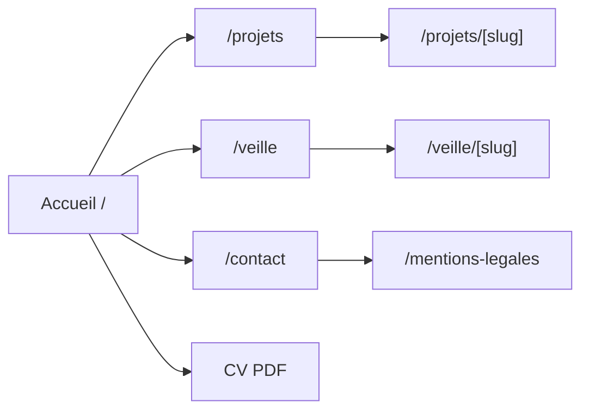

# Navigation

Comment le visiteur se déplace sur le site : le routage et la structure des pages.

## Routing

- Next.js App Router : les routes correspondent aux dossiers de `src/app/`.
- Les pages `[slug]` (projets, veille) sont générées au build via `generateStaticParams` à partir des fichiers MDX de `src/content/`.
- Cache Components est actif : `dynamicParams` est interdit. Un slug inconnu passe par `notFound()`, et `ensureStatic = 'navigation'` garantit un vrai statut 404 (sinon le shell partiel part en 200).
- `params` se lit sous `<Suspense>` (`EntryPageFallback`), même pour un slug prérendu : avec le prefetch partiel, l'App Shell commun à tous les slugs ne peut pas contenir les données d'URL. Sinon, en dev, l'avertissement Instant « encountered URL data during prerendering » s'affiche à chaque fiche.
- Toutes les routes sont publiques. Il n'y a ni auth ni route protégée.

## Structure

