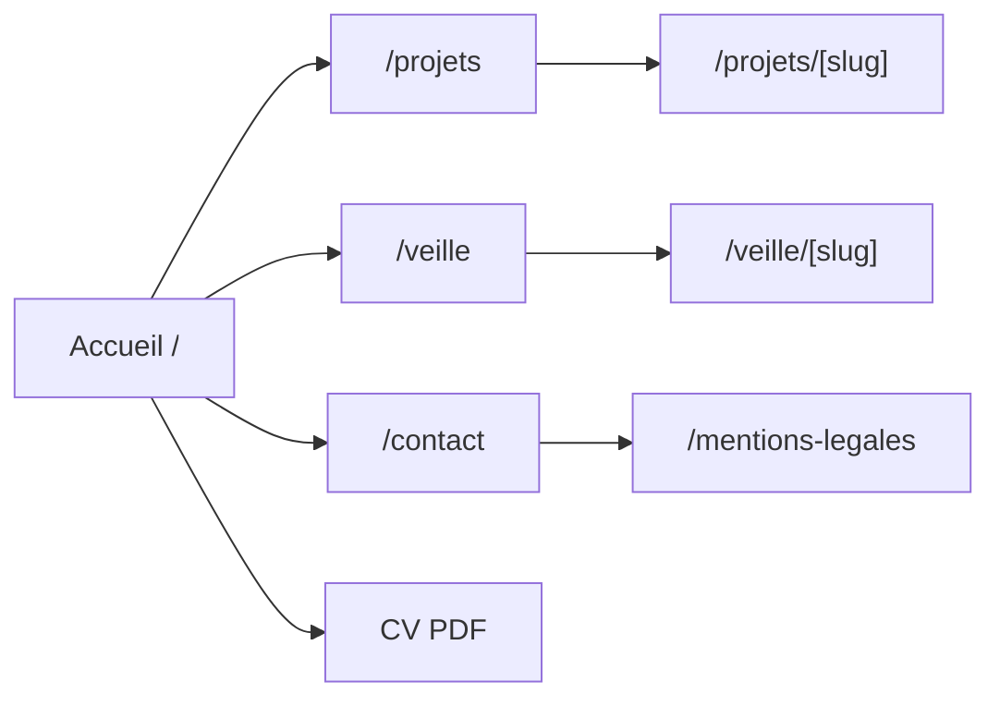

# Navigation

Comment le visiteur se déplace sur le site : le routage et la structure des pages.

## Routing

- Next.js App Router : les routes correspondent aux dossiers de `src/app/`.
- Les pages `[slug]` (projets, veille) sont générées au build via `generateStaticParams` à partir des fichiers MDX de `src/content/`.
- Toutes les routes sont publiques. Il n'y a ni auth ni route protégée.

## Structure

